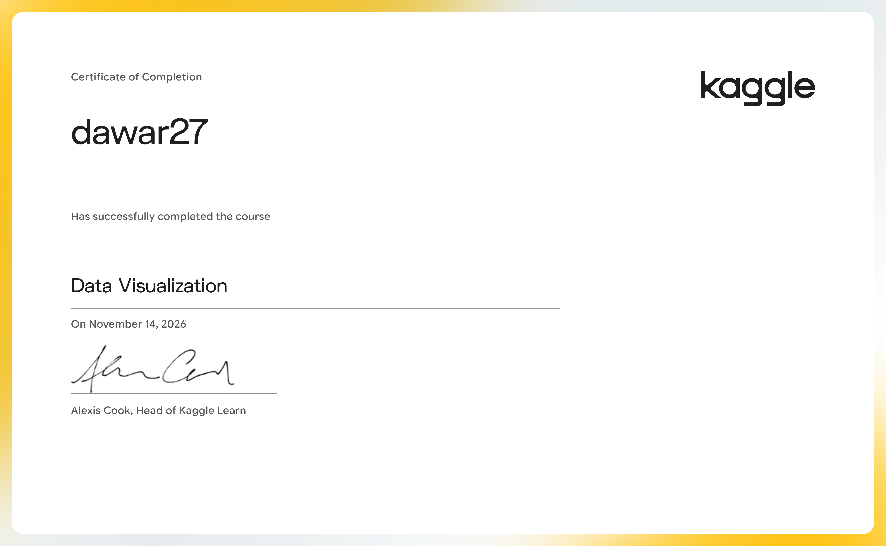
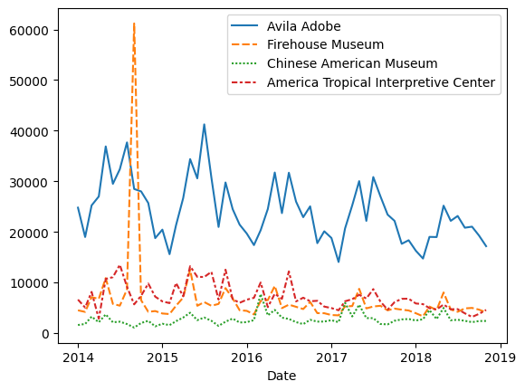
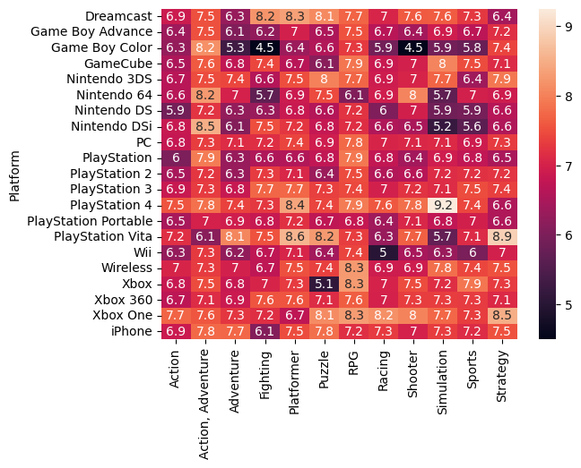
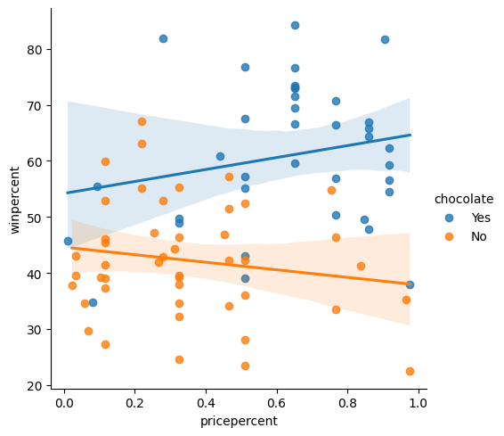
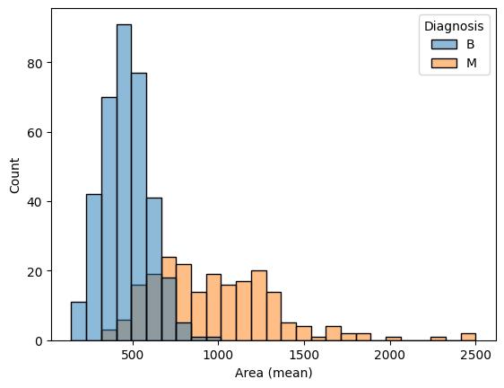

# Kaggle Learn — Data Visualization

My exercise notebooks from Kaggle Learn's [Data Visualization](https://www.kaggle.com/learn/data-visualization) course (instructor: Alexis Cook), completed on **November 14, 2026**.

**Student:** Dawar Ahmed · BS Data Science, FAST-NUCES Islamabad · Section DS-5B

## Notebooks

| # | Notebook | Dataset | Plots |
| --- | --- | --- | --- |
| 1 | [Hello, Seaborn](notebooks/01-hello-seaborn.ipynb) | FIFA world rankings | `lineplot` |
| 2 | [Line Charts](notebooks/02-line-charts.ipynb) | LA museum monthly visitors (2014–2018) | `lineplot` |
| 3 | [Bar Charts and Heatmaps](notebooks/03-bar-charts-and-heatmaps.ipynb) | IGN review scores by platform and genre | `barplot`, `heatmap` |
| 4 | [Scatter Plots](notebooks/04-scatter-plots.ipynb) | Halloween candy popularity | `scatterplot`, `regplot`, `lmplot`, `swarmplot` |
| 5 | [Distributions](notebooks/05-distributions.ipynb) | Breast cancer tumour measurements | `histplot`, `kdeplot` |

Every exercise in these notebooks passed the course's automatic checker.

## Tools

Python, pandas, Seaborn, Matplotlib (Kaggle Notebooks)

## Sample plots

| | |
| --- | --- |
|  |  |
|  |  |
